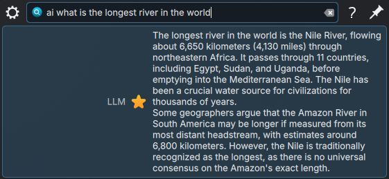
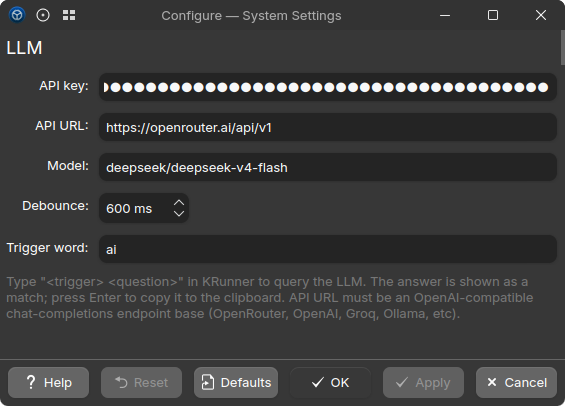

# krunner-llm

A KDE Plasma 6 KRunner plugin that answers natural-language questions
from your launcher by calling any OpenAI-compatible chat completions
API. Defaults to [OpenRouter](https://openrouter.ai); also works with
OpenAI, Groq, Together, local Ollama, LM Studio, etc.

Type `ai <question>` into KRunner (Alt+Space) and the answer appears as
a result, with bold, italics, inline code, code fences, lists, and
links rendered properly. Press Enter to copy the raw markdown source
to the clipboard.



## Requirements

- KDE Plasma 6 with KRunner 6
- KF6 + Qt 6 (runtime: `kf6-krunner`, `kf6-kcmutils`, `qt6-qtbase`)
- An API key for an OpenAI-compatible provider (e.g. [OpenRouter](https://openrouter.ai/settings/keys))

## Build & install

Build deps (Fedora 41+ package names):

```
cmake extra-cmake-modules gcc-c++ make
kf6-krunner-devel kf6-kconfig-devel kf6-ki18n-devel
kf6-kcoreaddons-devel kf6-kcmutils-devel kf6-kconfigwidgets-devel
qt6-qtbase-devel
```

System-wide install:

```sh
mkdir build && cd build
cmake .. -DCMAKE_BUILD_TYPE=Release
make -j$(nproc)
sudo make install
```

### Immutable hosts (Bazzite, Silverblue, Kinoite, …)

`/usr` is read-only on atomic Fedora, so build inside a toolbox/distrobox
and install into `~/.local`:

```sh
mkdir build && cd build
cmake .. -DCMAKE_BUILD_TYPE=Release -DCMAKE_INSTALL_PREFIX=$HOME/.local
make -j$(nproc) && make install
```

Then make Plasma look in `~/.local` for plugins by creating
`~/.config/environment.d/50-krunner-llm.conf`:

```
QT_PLUGIN_PATH=${HOME}/.local/lib64/plugins:${QT_PLUGIN_PATH}
```

Log out and back in so `systemd --user` reads it.

## First-time setup

After installing, restart krunner:

```sh
kquitapp6 krunner
```

Open **System Settings → Search → Plasma Search**, enable **LLM**,
click its gear icon, and paste your API key. Optionally change the API
URL, model, debounce, or trigger word.



## Configuration keys

Stored in `~/.config/krunnerrc` under `[Runners][krunner_llm]`:

| Key          | Default                              | Description                                          |
|--------------|--------------------------------------|------------------------------------------------------|
| `apiKey`     | *(empty)*                            | API key for the configured provider. **Required.**   |
| `apiUrl`     | `https://openrouter.ai/api/v1`       | Base URL of an OpenAI-compatible chat-completions API. `chat/completions` is appended automatically. |
| `model`      | `deepseek/deepseek-v4-flash`         | Model slug accepted by the configured provider.      |
| `debounceMs` | `600`                                | Wait this long after the last keystroke before firing. |
| `trigger`    | `ai`                                 | Prefix word. If you change it, edit the regex in `llmrunner.json` too. |

### Other providers

- **OpenAI direct**: `https://api.openai.com/v1`, model e.g. `gpt-4o-mini`.
- **Groq**: `https://api.groq.com/openai/v1`, model e.g. `llama-3.1-70b-versatile`.
- **Together**: `https://api.together.xyz/v1`.
- **Ollama (local)**: `http://localhost:11434/v1`, any pulled model (no key needed; put any string).
- **LM Studio (local)**: `http://localhost:1234/v1`.
- **Anthropic native API is *not* supported** — it isn't OpenAI-shaped. Use OpenRouter or a proxy if you want Claude models.

## Usage

```
ai why is the sky blue
ai write a haiku about file permissions
ai translate "good morning" to japanese
```

The runner is gated by `^ai\s` in the metadata, so it does nothing
(no network calls, no thread spawned) until you type the prefix.

## Errors you may see in the result list

| Result text                                           | Meaning                                |
|-------------------------------------------------------|----------------------------------------|
| *No API key set*                                      | Paste a key into the settings panel.   |
| *Invalid API key…*                                    | HTTP 401 — key revoked or wrong.       |
| *Payment required (402)…*                             | Provider needs a top-up.               |
| *Model "…" not found at the configured API URL.*      | HTTP 404 — wrong model slug for this provider. |
| *Rate limited. Try again shortly.*                    | HTTP 429.                              |
| *Server error (5xx).*                                 | Transient upstream failure.            |
| *Network error: …*                                    | DNS, offline, TLS, etc.                |

## Hacking

See [CLAUDE.md](CLAUDE.md) for build/install plumbing, KF6 API quirks,
and the threading model used inside `match()`.

## License

MIT — see [LICENSE](LICENSE).
